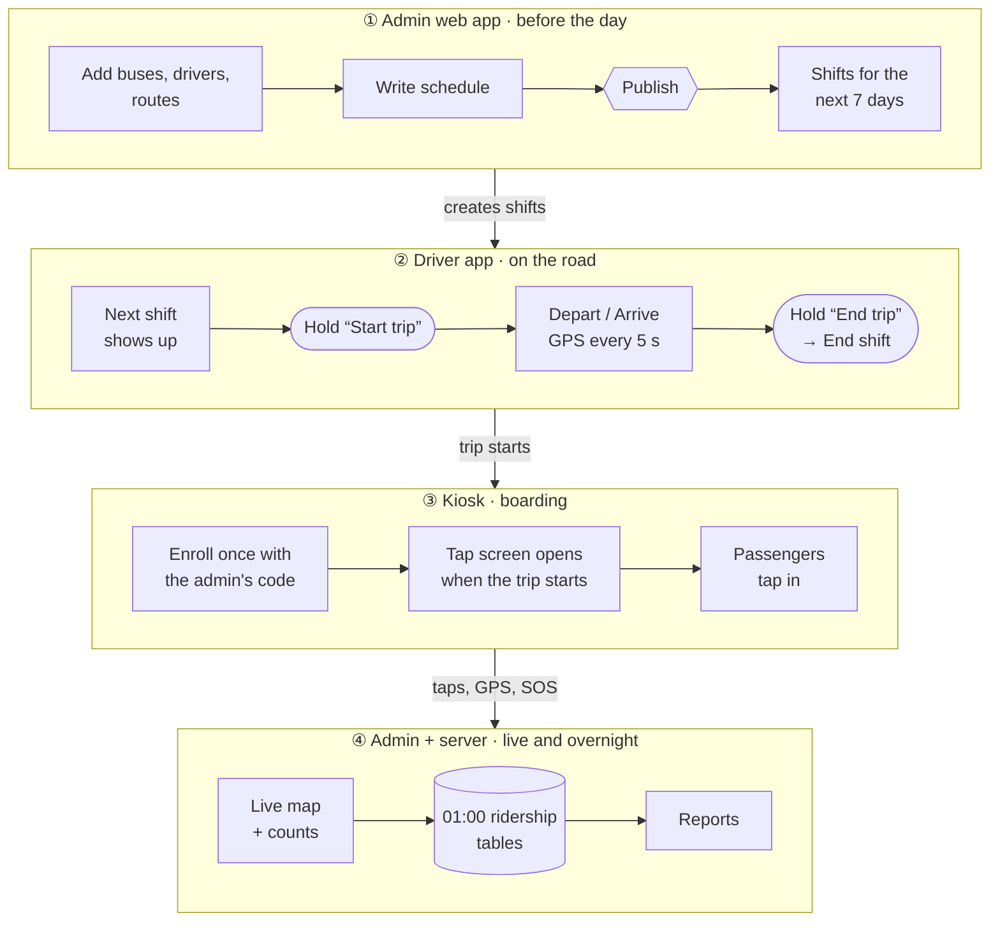

This page follows one bus through one day. Each step names the part of the system involved, so you know where to look in the code.

## Before the day: setup (Admin)

An admin adds the **buses**, **drivers** and **routes** (with their stops) in the web dashboard. This is done once and updated when things change.

Then the admin writes a **schedule**: which bus and driver run which route, on which days, at what hours. A schedule starts as a **draft**, which does nothing. When the admin clicks **Publish**, the system creates one **shift** (in the code, a `BusAssignment`) for each day the schedule covers, for the next 7 days. Every night at 00:30 a job tops up the next 7 days again.

Each bus also needs a **kiosk** linked to it. The admin creates a kiosk in the dashboard and gets a one-time **enrollment code**, which is typed into the kiosk (or into boarding mode on the driver's phone). After that the kiosk is tied to that bus.

See [Setting up service](/admin/setting-up-service) and [Kiosk setup](/admin/kiosk-setup).

## Starting a trip (Driver app)

The driver signs in with Bataeño Pass. The **Trip** tab shows their next shift. At the starting point they press and hold **Start trip**.

The server checks a few rules before it allows the start. The most common one to fail: **the bus must have a kiosk that is online** (it checked in within the last 3 minutes). Without it, no passenger could be counted, so the trip is refused. Other rules: it isn't too early or too late for the shift, the bus and driver have no other trip running, the route is active, the bus didn't fail inspection, and the driver isn't suspended.

When the trip starts, the bus is marked **On Route** and the driver **On trip**.

See [Running a trip](/driver-app/running-a-trip).

## Boarding passengers (Kiosk)

The kiosk asks the server every few seconds whether its bus has a trip running. As soon as it sees the trip, it switches to the **Tap your pass** screen. Before that, taps are refused with **Trip not started**.

A passenger taps their card or shows their QR code. The kiosk asks Bataeño Pass if it's a real pass and shows **green (Welcome aboard)** or **red (Ride denied)** right away. The tap is saved on the phone first, then uploaded to the server.

On the server, the tap is recorded straight away as "pending". A background job then checks it with Bataeño Pass again and fills in the passenger's group (regular, student, senior, PWD). The new count is pushed live to the admin map and the passenger tracker.

A passenger who taps again later is counted as getting off (**alighting**). Riders who never tap out are marked as off the bus automatically when the trip ends.

See [Tapping in](/kiosk/tapping-in).

## On the road (Driver app)

While the trip runs:

- The phone sends the bus's **GPS position** about every 5 seconds while moving (every 60 seconds while parked).
- The driver taps **Depart** when leaving a stop and **Arrive** when reaching the next one. The passenger tracker uses these times to estimate when buses will arrive.
- The driver can raise an **SOS** or report a problem. Both appear immediately on the admin's live map.
- Dispatch can **message** the driver.

If the signal drops, the driver app keeps GPS points and stop taps on the phone and sends them when the signal returns. The kiosk does the same with taps.

## Ending the trip (Driver app)

At the last stop the driver marks the arrival, then presses and holds **End trip**. The server closes the trip and marks anyone still on board as off the bus.

A shift can have more than one trip. After the first trip ends, the driver can **Start next leg**, which runs the return route (for example Abucay → Capitol, then Capitol → Abucay). When done for the day, they press **End shift**, which frees the bus and the driver. Shifts left open are closed automatically after their end time (checked every 15 minutes).

## Overnight (Server)

At 01:00 the server adds up the day's boardings into report tables. The admin's reports read from these. Ridership counts **boardings only**. A trip that was never ended is not counted.

Around 01:30 the server also "learns" from the day's trips (travel time between stops, waiting time at stops, how full buses get) to improve arrival estimates.

## What has to be running on the server

The flow above only works if these processes are all running. Locally, `composer dev` starts all of them.

| Process | What breaks without it |
| --- | --- |
| Web app | Everything |
| Queue worker (`queue:work`) | Taps stay "pending", live updates and notifications don't go out |
| Reverb, the live update server (`reverb:start`) | Maps and counts stop updating live (apps fall back to polling) |
| Scheduler (`schedule:work`) | No new shifts, kiosks never show as offline, stale shifts never close, no reports |

The full list of scheduled jobs, with a comment explaining each one, is in `libresakay-full/routes/console.php`.
