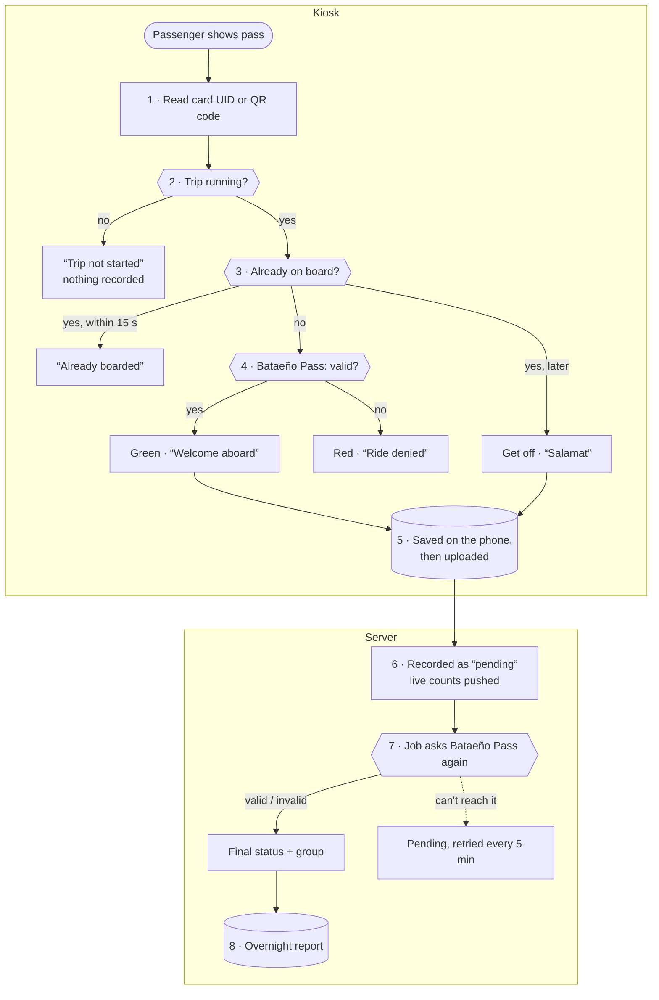
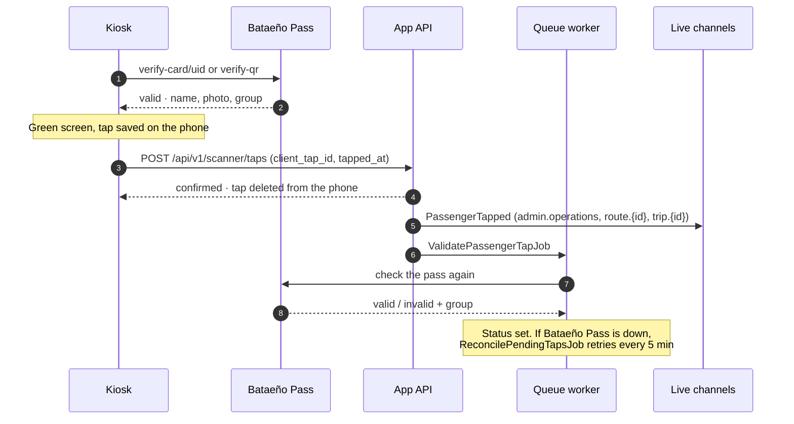

A tap goes through two checks. The **kiosk** checks it right away so the passenger isn't kept waiting. The **server** checks it again afterwards so the records are correct.

## On the kiosk

**1. Read.** A card gives its serial number (UID). A QR code from the Bataeño Pass app gives an ID. If the same pass is shown again within 2.5 seconds, it's ignored (`TapGate`), so holding a QR in front of the camera counts once.

**2. Trip running?** Every tap needs a trip to belong to. The kiosk keeps asking the server (`GET /api/v1/scanner/active-trip`) every few seconds. With no trip, it shows **Trip not started** and records nothing.

**3. Getting on or getting off?** The kiosk remembers who's on board (saved on the phone, so it survives a restart). `kiosk/BoardingCoordinator.kt` decides:

| Situation | Result |
| --- | --- |
| Not on board | Check the pass, then **board** ("Welcome aboard") |
| On board, tapped again within 15 seconds | **"Already boarded"**. Probably an accident, nothing is recorded. |
| On board, tapped again later | **Get off** ("Salamat"). No check needed, works without signal. |
| Got off earlier, taps again | Boards again, like a new ride |

**4. Check the pass.** The kiosk calls Bataeño Pass directly: `POST /api/client/verify-card/uid` for cards, `POST /api/client/verify-qr` for QR codes. If valid, the screen turns green and shows the name, photo and group. If not, it turns red with the reason.

**5. Save, then upload.** The tap is saved first in a small database on the phone, then uploaded to `POST /api/v1/scanner/taps`. A tap is deleted from the phone only after the server confirms it. Each tap carries:

- a **unique ID** made by the kiosk (`client_tap_id`), so a tap sent twice is never counted twice, and
- the **time of the tap** (`tapped_at`), so a tap uploaded 20 minutes late still counts at the right time.

::note
The kiosk sends times in UTC. The server stores Manila time. Any new code that accepts a time from a device must convert it.
::

## On the server

**6. Record.** `app/Actions/Taps/RecordPassengerTap.php` saves the tap right away with status **pending**. If the same passenger is already on board this trip, the tap is marked **duplicate** instead. A "get off" tap is accepted as is, with no check.

Then it pushes the new count to everyone watching (the `PassengerTapped` event):

- the admin live map (`admin.operations`)
- the passenger tracker (`route.{id}` and the fleet channel)
- other kiosks on the same trip (`trip.{id}`)

**7. Confirm.** A background job (`ValidatePassengerTapJob`) asks Bataeño Pass again and sets the final status: **valid** or **invalid**, and the passenger's group (regular, student, senior, PWD). If Bataeño Pass can't be reached, the tap stays pending, and a job every 5 minutes tries again (`ReconcilePendingTapsJob`). This is why a running **queue worker** is required.

**8. End of trip.** When the trip ends, anyone still on board is marked as off the bus, both on the kiosk and on the server (`SweepTripAlightings`). These are flagged "auto alighted" so reports can tell them apart.

Tap statuses (`TapValidationStatus`): Pending, Valid, Invalid, Duplicate, Service unavailable.

The same steps as a timeline, showing who talks to whom:

## When there's no signal

The kiosk keeps working in dead zones.

- **Taps** stay in the phone's queue and upload in order when the signal returns. Nothing is lost if the phone restarts.
- **Getting off** works normally, because it doesn't need a check.
- **Boarding** can't ask Bataeño Pass, so the kiosk only accepts passes it already knows:
  - passes this phone has accepted before, and
  - the fleet-wide list of known passes, downloaded from `GET /api/v1/kiosk/credential-list` while online.

  An unknown QR code is refused while offline, because anyone can print a random QR code. A pass on the block list is always refused.

- If Bataeño Pass itself is down (but our server is fine), the kiosk notices and stops trying it for a while, so each passenger doesn't wait for a timeout.

When the driver started the trip offline, the kiosk on the same phone follows it anyway: the driver app tells the kiosk about the offline trip (`HostTripBinding`), and the taps upload once that trip reaches the server.

## If the server refuses a tap

`scanner/TapUploader.kt` handles each kind of refusal so the queue never gets stuck:

- **The trip changed** (for example the driver started the next leg): the tap is moved to the current trip and sent again.
- **Too many requests**: wait as long as the server asks, then retry.
- **Server can't be reached**: retry, waiting a little longer each time, and immediately when the network returns.
- **Key rejected** (the kiosk was revoked): keep the taps and show a warning. Only an admin can fix this, by enrolling again.
- **Bad tap** (for example a wrong clock): set aside so the taps behind it can go through. It's retried later and after each restart, since some problems fix themselves.
